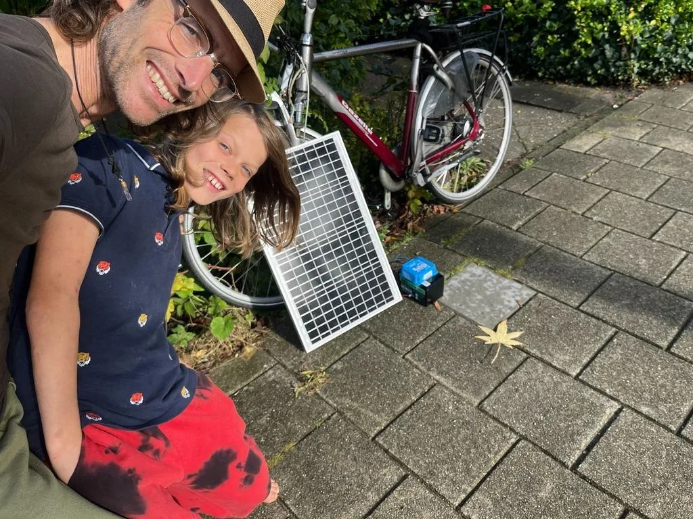
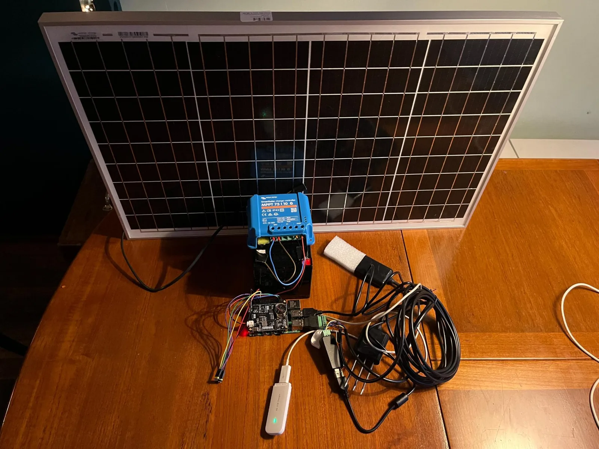
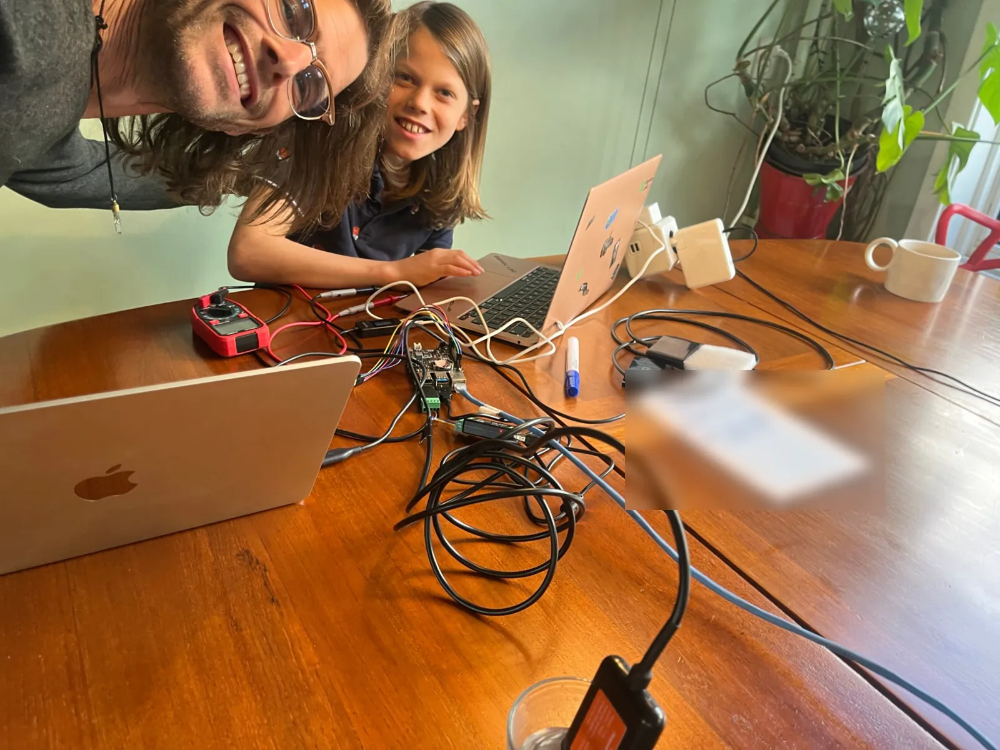
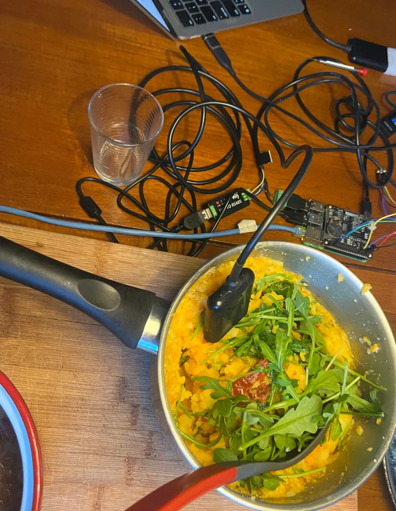
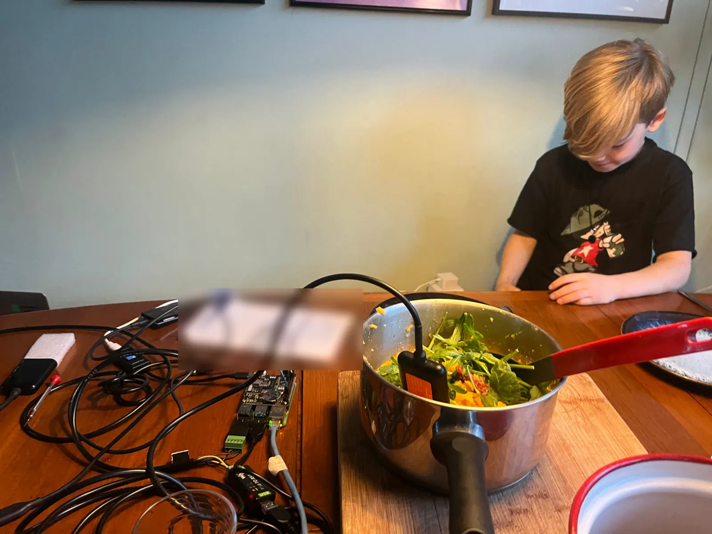
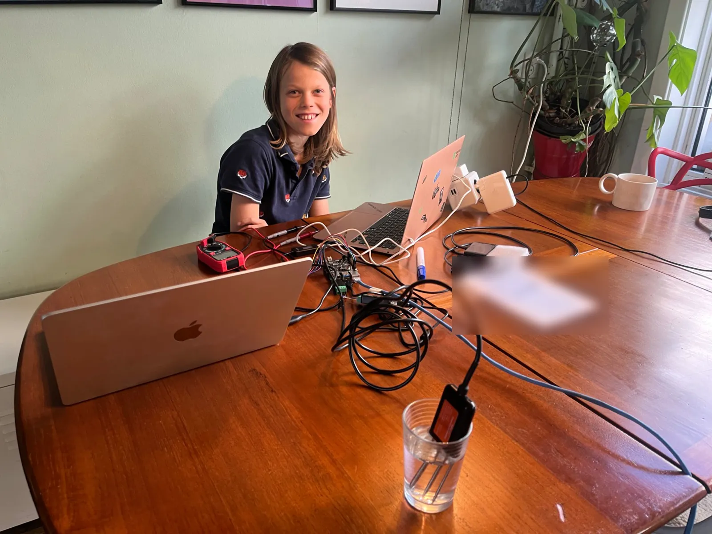

The [build guide](index.md) tells you what to do. This page tells you why it says that: every entry is something the first box, node 1, taught us on a desk, and what changed in the concept, the software or the plan as a result. Nothing here is modelled; it all happened. Numbers that were measured are also in [`kit/bench-log.csv`](https://github.com/oncra/life/blob/main/kit/bench-log.csv), next to what we had expected.

An entry is one of three kinds: a **learning** (something we now know), a **change** (something we did about it), or a **fun fact** (neither, but worth keeping).

## 12 October 2026

### Every ordinary pause showed as a missed post

*Learning.* Since the box went over to one message every three hours (11 October), the dashboard still expected one every two. So each ordinary pause was drawn as a red band, a post gone missing: today the box reported at 07:28, 10:28 and 13:28, exactly three hours apart, and both pauses in between showed as missed. A box that was fine also read as "quiet" for the last hour before each message. The rhythm is now three hours in one place in the code, and a silence counts as missed only after three and three-quarter hours, the same margin as before.

### One bird, one name, and the birds for other sites

*Learning.* Node 1 had heard 35 species by name but only 30 by scientific name: five birds arrived under both. The jackdaw came in as "Eurasian Jackdaw" and as "Coloeus monedula", and the carrion crow, the magpie, the tree pipit and the common redstart did the same. BirdNET-Go's own database keeps only the scientific name; the box asks BirdNET-Go for the common one, and when it has none to hand it sends the Latin rather than make a detection wait. So the dashboard showed the crow twice among its last five, and the diversity reading counted those five species twice, where the spec says distinct species. A species is now its scientific name everywhere it is counted (the diversity reading, the life index, the dashboard's species table and its last five), and the row takes a common name if any detection or picture of that bird carries one.

*Change.* The last birds heard are open data: `/api/v1/heard` gives the newest species, one per species, each with its cut-out, the photo's credits and its common names in six languages from Wikidata, so a Dutch page can say "Zwarte kraai" where the box says "Carrion Crow", plus whether each node is listening or asleep. It says what was heard and when, never where. Climate Cleanup's home page uses it to show the birds as they come in. [#87](https://github.com/oncra/life/pull/87)

### The oracle's disk filled up with old builds

*Learning.* The first deploy of the bird pictures stopped halfway with "no space left on device", while the site kept running the previous build as if nothing had happened. The disk is 38 GB; 19 GB of it was Docker's build cache, one layer set per deploy since the site began, never cleared. Pruning it by hand gave 22 GB back and the second deploy went through. The deploy script now keeps the most recent 3 GB of layers after every build and drops the rest, so rebuilds stay fast and the disk stays free. [#86](https://github.com/oncra/life/pull/86)

### The last five birds, cut out and standing on the page

*Change.* Under the title of the dashboard stand the five species the microphone heard most recently, newest first, each as a cut-out photo on the page's own ground, with when it was heard and how sure the box was. The photos are the lead pictures of the species' Wikipedia articles, taken from Wikimedia Commons with their authors and licences (credited under the row), and the background is removed once per species by the worker with U²-Net, an open salient-object model, run through onnxruntime on the oracle; the result is a small WebP with transparency, 16 to 55 kB, stored next to the credits. Nothing runs while you look at the page. Of the 27 species heard so far, all 27 got a picture on the first pass; the one thing to check by eye is whether an article's lead photo shows the bird itself and not its eggs. The first pass also taught a sharp lesson about the image library: it handed the scaled mask back with three channels, which read as one gave five striped ghosts before it gave birds. [#85](https://github.com/oncra/life/pull/85)

### The life index, first on the page

*Change.* The dashboard now opens with what the whole project is for: one verdict for the place, read from three streams on one timeline. A band shows the verdict per quarter (the weakest of the seven readings; nothing is summed, and a stream that has not spoken makes it *insufficient*, on purpose), and under it the three lanes it is read from: satellite greenness per clear scene since 2019 with the growing seasons shaded, species heard per day, and the soil's moisture and temperature as daily means, with a dotted line where the node arrived. Hovering reads all three for a day, including the soil-breathing index the cycling reading uses. For the bench that is a plain picture: 321 clear scenes since 2019, productivity read as rising, six readings unknown, verdict insufficient, four days of sound and soil at the far right. The globe lost its black and took the site's own colours, dragging it now moves the ground with the finger, and the map moved under the globe, zoomed out two steps and folded away until asked for. [#82](https://github.com/oncra/life/pull/82)

### The bench node is on the builder's page too

*Change.* The builder's page (`/box`) only knew the boxes whose software was made there. Node 1 was built by hand, so it was not on it, while the box made there for its future home in Scheerwolde sat on the page saying "not heard from yet". Confusing, with one real box and two names for it. A node built by hand on one of your places now has its own card on that page, with the same lights and the link to its measurements over time, and a line saying its software did not come from there. When node 1 moves to Scheerwolde, its three devices move to that place with it. [#81](https://github.com/oncra/life/pull/81)

## 11 October 2026

### The node on a globe, its posts as light

*Change.* The dashboard was informative but not something you would show anyone. It now opens with a globe: the Earth as rows of dots, every node a glowing point with rings that keep running while it is being heard, and each post a pulse of light that travels along an arc from the node to the oracle in Nuremberg, where this site runs. It turns slowly around the node by itself and can be dragged. Drawn on a canvas in the browser from 4,670 land points taken once from Natural Earth; nothing is loaded while you look at it. The idea came from the globe in a hacking kit a ten-year-old builds with, restyled to this site's colours. [#76](https://github.com/oncra/life/pull/76)

### The battery setting has another name in the app

*Learning.* The guide said to choose the LiFePO4 battery preset on the charge controller. In the VictronConnect app there is no setting by that name: it is **Smart Lithium (LiFePO4)**, under settings (the gear wheel), Battery preset. The guide now uses the app's own words. [#75](https://github.com/oncra/life/pull/75)

### A line each time the box reports in

*Change.* With the box on its field schedule it is off most of the day, and the only way to know it woke up was to go and look at its page. The oracle can now send one short line somewhere you already look, each time a box reports in: *started, battery 12.94 V, 16 °C in the box*, *checked in*, *switching off*. An alert, such as a low battery, goes to the same place marked as urgent. It is a setting on the oracle (a web address to send the lines to), off unless someone fills it in. [#74](https://github.com/oncra/life/pull/74)

### The box said it had moved while it stood on the desk

*Change.* The 4G stick has no GPS, but every message carries the mobile mast the stick is talking to, and the oracle used that to notice a stolen box: the first mast heard was home, any other mast meant *moved*. Seventeen minutes after the stick first reported a mast, the alert went off, with the box on the same desk. In one afternoon it reported five different masts, on two phone networks and on both 3G and 4G: a box that stands still is passed around all the time. Home is now everything the box hears in its first two weeks. After that, a new mast in a neighbourhood it already knows is added quietly, and only a mast in a neighbourhood it has never been in raises the alert; the alert closes by itself when the box is heard from home again. The price: a box taken in its first two weeks, or moved a few streets, is not caught this way. The siren and the lid switch are there for that. In the same change the box now sends every three hours instead of every two, which saves about 3 MB a year: most messages go out when the box starts and when it stops, not in between. [#73](https://github.com/oncra/life/pull/73)

### A page that shows what the box did, not just what it last said

*Change.* Until today the site showed only the latest value of everything: the lights on the builder's page and a device table on the place page. Whether a post went missing last night, how the battery did over the week, when the birds sang: none of it could be seen. Every node now has a page, `/places/<place>/node`, with everything it posted over time. A strip of heartbeats, where a silence longer than the two-hour rhythm shows as a band (blue after a planned shutdown, red when a post just did not come); moisture and temperature per probe; battery, temperature inside the box and power from the heartbeats; the species heard today, this week and ever, with a grid of detections per hour of the day so a dawn chorus shows as a dark column; and a map where the node pulses while it is being heard and now and then says what it last heard. The same pulses are on the site's map for every node. The page is public for every place, also a private one, because it tells what the box measured and never where it stands: the public gets a point blurred to a few kilometres and never the mobile cell the box was in. What node 1 shows after four days on the desk: 47 posts, two unplanned silences (the longest when it was simply switched off for two days), probes reading 0% in the air and 49 to 50% in the planter, and 34 detections from played recordings, most of them in one evening. [#72](https://github.com/oncra/life/pull/72)

### One connection for everything, every two hours

*Change.* The box used to open three secure connections an hour: one for the birds and "I am alive", and one for each soil probe. Setting up such a connection costs about 6.5 kB before a single reading has been sent, which is why the three together came to 28 kB. Now the soil probes only write their readings down, and one program sends everything over one connection: three minutes after the box starts, every two hours after that, and once more before it switches off. Measured on node 1: **11.8 kB** for a message with the birds, the box's own state and both probes, where the same content used to cost 27.7 kB. Over a year of the planned schedule that is about 28 MB, a little over half of what the SIM holds. A side effect on the desk: the soil lights now turn green three minutes after the box starts instead of after forty. We also tried to stop the 4G stick from spending data on its own. It cannot be stopped: three starts in a row it used 7.4 kB while the box sent nothing, also with its update settings off. At two starts a day that is 5 MB a year, which is counted in the 28. [#71](https://github.com/oncra/life/pull/71)

### Where the SIM's data really goes

*Learning.* This morning's 17.7 kB for one hourly message came from the stick's own counter. Counting the packets on the box itself gives a different picture, in three parts. The hourly message with the birds and "I am alive" is **9.6 kB**, less than the 12 kB we had planned. The soil readings go separately, and each of the two probes opens its own secure connection: **18 kB** an hour, twice the size of the message we had been worrying about. And the stick spends data by itself: 6 to 15 kB every time it starts, while the box sends nothing at all. Together that is about 28 kB an hour, or 105 MB a year at ten hours a day, against the 50 MB a year the SIM gives. So the card would last about five years, not ten. The way out is plain: one connection an hour that carries everything, which brings the hour to about 11 kB and the year to about 40 MB. Not built yet. [#70](https://github.com/oncra/life/pull/70)

### A new image, started on node 1 before anyone else gets it

*Change.* Everything learned since 7 October went into one new image: the order cable, WiFi, SIM, the start without the two-minute wait, and the fixes that had been put on node 1 by hand. Node 1's card was written with it and started. The soil timer ran two minutes after the start and read both probes, the first hourly message went out a minute later and the oracle answered, the microphone was being listened to, and with the stick in, the way out was WiFi. Only then did it become the image others download (image-v4). Not tried on this image yet: switching itself off and on by the clock, and a whole day on the SIM alone. The stick, on the same desk, was back on 4G (signal −104 dBm). [#69](https://github.com/oncra/life/pull/69)

### Two minutes of waiting at every start

*Change.* After each start the box sat still for two minutes before its timers began: the hourly message and the soil readings waited on a network service that has nothing to manage on this computer and so could only give up after its time ran out. On a desk nobody notices; in the field it is two minutes of battery every morning with nothing heard and nothing sent. The next image leaves that service out, together with a daily software-update check that has nothing to update on a box whose system cannot be written. [#66](https://github.com/oncra/life/pull/66)

### Cable first, then WiFi, then the SIM

*Change.* With the 4G stick in the Pi, the box sent everything over the SIM, also on a desk with a network cable and WiFi within reach: the clock, the weather lookup, every message. The stick presents itself to the computer as a network cable, so it was treated as the best way out. The SIM holds 500 MB for ten years, so that matters. The box now picks in a fixed order: a network cable if there is one, WiFi if not, and the SIM only when it has neither. Tested on node 1 by taking the cable away, then the WiFi, and watching which way a message to the oracle went each time; with both gone it arrived over 4G, and with both back it left the SIM alone again. It is part of the next image. What it does not catch: a cable or WiFi that is connected but has no internet behind it. [#64](https://github.com/oncra/life/pull/64)

### One hourly message costs more data than planned

*Learning.* The plan counted 12 kB for the message the box sends every hour. Measured on the stick's own counter, with nothing to report but "I am alive": **17.7 kB**. Nearly all of it is the greeting that sets up a secure connection, not the message. Ten messages a day at that size is about 65 MB a year, and the SIM gives 50 MB a year, so as it stands the card would run out after about eight years instead of ten, before soil readings and anything else the box does on the internet are counted. One measurement, so no conclusion yet; the next step is to count everything a day in the field would send, and then make the greeting smaller or the messages fewer. Also seen: in five idle minutes one burst of 7 kB went out that we cannot yet name. [#64](https://github.com/oncra/life/pull/64)

### Three USB plugs do not fit side by side

*Change.* The Pi has four USB sockets in two pairs, one above the other, close together. The RS485 adapter, the screw terminal for the probes and the 4G stick are each wider than a socket, so they push each other out. Two short USB extension leads solve it: one for the RS485 adapter and one for the 4G stick, while the screw terminal sits in the Pi itself. Both leads are now on the order list and in the guide. One lead was not enough. [#64](https://github.com/oncra/life/pull/64)

### The SIM is a foreign card everywhere

*Change.* With the SIM the right way round the stick found the network and then refused to use it: *Data connections are disabled while roaming*. The 1NCE card is not from any one country, so it is roaming wherever it is, and the stick ships with roaming off. The guide now has that switch as its own step. On the desk the stick held 4G in the laptop (signal −95 dBm) and dropped to 3G an hour later in the Pi, a metre away: indoors is not where this box will live, but it is the number the closed box will be compared with. [#64](https://github.com/oncra/life/pull/64)

### The charge controller's app is hard to find, and it wants a code

*Change.* The blue Victron charge controller is set up from a phone, with an app called VictronConnect. The guide named the app and nothing more. In practice the controller's own packaging does not say so clearly, the QR code printed on it does not lead to the app, and Victron's website does not put it in front of you; what worked was searching the App Store by name. Then the app found the controller over Bluetooth and asked for a PIN, which turned out to be on a sticker on the side of the controller. The step now carries two QR codes that open the app in the store, one for iPhone and one for Android, and says where the PIN is. A printed card with the same two things belongs in a kit that ships.

Once paired, the panel and battery went outside for their first real sun. The app read **20 W** off the panel (19.97 V, 1.0 A), the battery at 13.30 V taking 1.40 A and still in **Bulk**, the controller's fastest charging stage. A fifth of the panel's 100 Wp rating, on an October afternoon with the panel not angled for the sun — not a yield measurement, but the first proof, outside any model, that panel, controller and battery work as a chain.

### The SIM goes in face down

*Change.* The 4G stick's own page said *SIM card not inserted or not working*. The card was in, with its gold contacts facing up. Turned over, with the contacts down and the cut corner towards the USB plug, the stick found it. The guide said only "slide the SIM into the stick"; it now says which way round, shows a photo of node 1's stick with the card in place, and says what that message means. The stick reads the card only when it starts, so it has to come out of the laptop and go back in after the card is turned.

## 10 October 2026

### The box now says how it is doing

*Change.* Until today the hourly message said that the box was alive and where it was, but not how it was. Now it also carries the battery, the temperature inside the box and how much power the computer draws. None of it needs a new part: the Witty Pi, the board that switches the computer on and off, already measures the voltage coming in from the charge controller, which is the battery's voltage less a few tenths, and it has a thermometer on board. When the charge controller's own cable is plugged in, the message also carries the solar panel's watts, the charge state and how much energy the panel gave today and yesterday. It is about 250 bytes on a message that is sent anyway, so it costs no extra connection and less than 2 % of the SIM's ten years. The box page shows it as three more lights, with the week's lowest and highest battery; a battery under 12.0 V sends a *low battery* warning, and 12.8 V clears it. On the desk the box runs on USB at 5 V, so its battery light stays grey until it is on the real battery. ([#61](https://github.com/oncra/life/pull/61))

## 9 October 2026

### A new name: Life Node

*Change.* The box was called the Life Box. That name is already registered as a trade mark by several companies, some of them for electronic devices, and a surgical-safety charity has used it for years. It is now the **Life Node**: one node of the Life Oracle, the system that learns from every node whether life is coming back. The guide moved from /lifebox to /node; old links still work.

### The first night on its own

*Learning.* After the desk tests the 30 cm probe went into a planter in the living room and the box was left alone. From 22:14 to 07:34 it took a reading every twenty minutes and sent them every hour: **29 readings out of 29**, nothing missing, nobody touching it. The soil went from **52.0 % to 49.3 %** moisture, by 0.9 in the first forty minutes after the probe went in and then about 0.2 an hour, and cooled from 19.5 to 18.8 °C. The second probe lay loose on the table and read the room: 0 % and 21.1 falling to 19.5 °C. The soil stayed cooler than the air and changed more slowly, which is what soil does. The 52 % itself is for potting compost, which holds far more water than a field does; in a planter the change is the reading to trust, not the level.

## 8 October 2026

### Dinner is 60 °C

*Fun fact.* The 30 cm soil probe had just passed its test in a glass of water when dinner arrived on the same table. So the probe went into the pan. It read **100 % moisture and 57 to 60 °C**, rising while we watched. The probe is rated to 80 °C, so mash is within specification.

The serious half of that hour: the same probe read **0.0 % in air, 100.0 % in water** and climbed from 20 to 26 °C in a warm hand. The way the node turns the probe's raw numbers into moisture and temperature had been written from the datasheet and had never met a real probe. It holds at both ends. ([#50](https://github.com/oncra/life/pull/50))

### The first list of birds: 22 species in twelve minutes

*Learning.* We played field recordings from a phone next to the microphone, one species after another. The box named **22 species in 31 detections**, 20 of them with a confidence of 90 % or more: robin, blue tit, great tit, goldfinch, blackbird, willow warbler, song thrush, house sparrow, wren, chiffchaff, chaffinch, brambling, blackcap, garden warbler, woodlark, tree pipit, common redstart, sedge warbler, linnet, stonechat, greenfinch and white wagtail. It kept apart the pairs that people confuse: willow warbler and chiffchaff, blackcap and garden warbler. The detections go to the oracle with the box's hourly message. ([#53](https://github.com/oncra/life/pull/53))

### The coin cell will outlive the box

*Learning.* The Witty Pi keeps its clock running on a CR2032 coin cell when it has no power. Would that cell last the ten years we want from a box? UUGear's manual gives the clock chip a draw of about 0.22 µA. A CR2032 holds about 225 mAh, so on paper that is **more than a hundred years**. And the clock only draws from the cell while the Witty Pi has no supply at all, which in a box with a battery is a few days a year. The cell's own shelf life, about ten years, is the limit, not the load. The coin cell is not what bounds the ten-year target. We replace it at a major service anyway, because it costs less than a euro and the box cannot measure it.

One caution we keep: the same manual says "about 4 µA" in another chapter. Even at that figure the cell would run the clock for six years without any supply, which a box never asks of it.

### The box draws about half of what we modelled

*Learning.* Every energy number in the kit rested on "about 5 W while awake". Measured on node 1 with the microphone listening and both probes connected: **2.75 W in a quiet room, about 3.5 W while birds sing without a pause**. Recognising birds costs power only when there is something to recognise, so a dawn chorus is about 0.75 W dearer than silence. The modelled 5 W stays in the tables until the 4G stick and the evening's bat model have been measured too; after that the battery and the panel can probably shrink. ([#51](https://github.com/oncra/life/pull/51), [#55](https://github.com/oncra/life/pull/55))

*Learning.* The Witty Pi's own sensors read 2.82 W where the meter read 2.75 W. They agree within 3 %, so a box can log its own power draw in the field, with nobody standing at a meter.

### Off now means off: 0.0 W

*Change.* When the box shut down, the Witty Pi was supposed to cut the power. It did not: the Pi sat there "off" and drew 1.1 to 1.8 W, more in one night than the whole winter budget of a day. Three things were missing, all of them in the image and none visible from outside: the Witty Pi watches one specific serial pin to see that the Pi has stopped, the Pi was not driving that pin, and the Witty Pi only starts watching after a signal that its own software sends, which could not run because one small program was not installed. With all three in place the meter read **0.0 W** seven seconds after a shutdown. ([#17](https://github.com/oncra/life/pull/17), [#45](https://github.com/oncra/life/pull/45))

*Change.* A Witty Pi fresh from the factory waits for a press on its button before it starts the Pi. A box whose battery ran flat in a dark week would then stay off until someone walked into the field. The image now sets the board to start the Pi as soon as power arrives.

### The power wire goes in +, not in S

*Change.* The first probe said nothing, at any speed. Its brown wire sat in the screw marked **S** of the USB screw terminal. S is the cable's shield, not power; the probe had no supply. Our drawing called the screws VCC and GND, which the part in the kit does not. The drawing and the step now show the five screws as they are marked, **S, +, D−, D+, −**, and name S as the first thing to check when a probe stays silent. ([#47](https://github.com/oncra/life/pull/47))

### Talking costs birds, and a zero deserves a second look

*Learning.* The box throws away every few seconds of sound in which it hears a human voice, birds included. That is how it keeps the promise that it never records people. On a desk it costs detections: three minutes with people talking gave 7 detections, the next three minutes in silence gave 14. The guide now asks for a quiet room and a recording without a narrator. ([#52](https://github.com/oncra/life/pull/52), [#53](https://github.com/oncra/life/pull/53))

*Learning.* For an hour we believed the box had heard nothing at all, and wrote that into the guide. It had heard 23 birds. The program we used to watch it asked the same question every five seconds and kept getting the first answer back from a cache. The guide was corrected the same evening. What we keep from it: before explaining a zero, ask once more in a different way. ([#54](https://github.com/oncra/life/pull/54))

### A tested image, for everyone

*Change.* The image that anyone can download had never started on a Raspberry Pi; the first public one, of 29 September, could not. Since today the public download and the per-box images at [life.oncra.org/box](https://life.oncra.org/box) are the image that node 1 runs: it starts by itself, sets its clock, hears the microphone, reads the probes, reports to the oracle and switches off properly. ([release image-v2](https://github.com/oncra/life/releases/tag/image-v2))

*Change.* A box on a desk should stay on while you wire it. `SCHEDULE=none` does that; before, the desk schedule switched the box off 45 minutes in every hour. ([#46](https://github.com/oncra/life/pull/46))

## 7 October 2026

### The clock comes first

*Change.* A new box shut itself down one minute after its first start. The Witty Pi's clock had never been set, the Pi copied that wrong time at startup, and the Witty Pi's own software then switched off the Pi's time synchronisation, so the wrong time stayed. A schedule computed from it said "time to sleep". Now the box first gets the right time and writes it into the Witty Pi, and only then computes a schedule. With no trustworthy time it plans no shutdown, stays on and tries again. ([#43](https://github.com/oncra/life/pull/43))

### Awake when the birds are, not when the clock says

*Change.* The summer schedule was ten hours from five in the morning, the same in March and in June. It now follows the sun at the box's own place: eight hours from civil dawn and two hours from sunset, so the dawn chorus, the evening chorus and the first hours of the bats all fall inside a window. ([#43](https://github.com/oncra/life/pull/43))

### A second listener, and the bats

*Change.* Perch v2 now runs beside BirdNET on the box, and every detection says which model made it. The kit gained a design for hearing bats, with the energy it would cost calculated before any part is bought. ([#42](https://github.com/oncra/life/pull/42), [#44](https://github.com/oncra/life/pull/44))

## 5 October 2026

### A microphone that is wired wrong is perfectly silent

*Learning.* We expected a badly wired microphone to hiss. It gives exactly nothing: every sample is zero. The Pi shows a sound card either way, because the sound card comes from a setting and not from the microphone. So "the Pi sees a microphone" proves nothing; only a signal does.

### The box was listening to a microphone that does not exist

*Change.* With the wiring right, sound arrived and still no bird was named. The bird recogniser had been told to listen to a device called `sysdefault`, which on a box does not exist. It reported no error and analysed silence. Pointed at the real microphone, it named a **blackbird at 96 %** within half a minute: the first bird a Life Node ever heard. ([#41](https://github.com/oncra/life/pull/41))

*Change.* The blackbird then stayed on the box. The program that sends detections to the oracle did not understand the recogniser's current database, stopped, and took the hourly "I am alive" message down with it. Both go out now. ([#41](https://github.com/oncra/life/pull/41))

### An empty card looks like a broken Pi

*Learning.* A steady green light and nothing on the network: the files the Pi starts from had been dragged to the bin on a laptop. A steady green light means the Pi found nothing to start from. Look at the card before suspecting the Pi.

## 1 October 2026

### One page, no terminal

*Change.* The plan was six pages of stages, written for someone with a command line. It became one page of plain steps from ordering to the field, each with a check you can see as a light on your own box page. You name your box, give the WiFi and download a card image made for it, so nobody types a password or a token into a file. ([#20](https://github.com/oncra/life/pull/20), [#28](https://github.com/oncra/life/pull/28))

*Change.* Both soil probes leave the factory with the same address. The plan had a person typing commands to change one. Now the box does it: connect one probe alone, and the first time the box sees a single probe it gives that probe the second address by itself.

## 30 September 2026

### The first start, and four faults nobody could have seen on a workstation

*Learning.* The image had been built and inspected on a workstation, never started on a Pi. On the Pi it hung with one red light. The build had given the card a new identity while the startup file still asked for the old one, so the Pi waited for a disk that was not there. Once past that, three more faults showed, each invisible until the box ran: trailing comments in the settings file were read as part of the values, the bird recogniser's settings had been written to a place the running box hides, and WiFi stayed off because the base system ships with the radio disabled. An image is not finished until it has started on the real thing. ([#15](https://github.com/oncra/life/pull/15))

### A Pi that is "off" is not off

*Learning.* A Raspberry Pi 4 that has shut down while its supply stays connected draws **1.8 W**, more than it draws idle. Nothing in the kit's energy tables had counted on that. It is the reason the Witty Pi has to sit in the supply line and really cut the power, which took until 8 October to get right.

## 24 and 25 September 2026

### Theft and tampering became software

*Change.* The first idea against theft was a coin-cell tracker in the box. Instead the box reports, with every hourly message, which mobile cell it is in. The oracle remembers the first one as home, raises an alert when a box reports from elsewhere, and another when a box that had been heard falls silent for 36 hours. No extra part, nothing that beeps. A small guard board with a siren covers the lid and the panel, and stays quiet only inside a maintenance window that the owner opens. ([node README](https://github.com/oncra/life/blob/main/node/README.md))

### A smaller battery

*Change.* Simulating the sun on an unshaded panel, hour by hour, showed that a 40 to 50 W panel with a 10 Ah battery is enough on open ground. The kit had assumed 100 W and 20 Ah. The measurements of 8 October point the same way.
